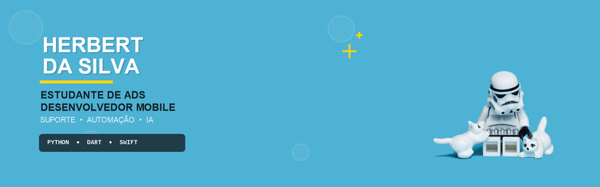
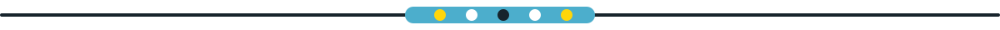

<div align="center">
  
</div>

<div align="center">
  <a href="https://github.com/HerbertsDev">
    
  </a>
  <a href="https://www.linkedin.com/in/herbert-da-silva-da-cruz-b001942b0/">
    
  </a>
  
</div>

<br />

## 👨‍💻 Sobre mim

```text
> Estudante de Análise e Desenvolvimento de Sistemas
> Desenvolvedor Mobile
> Suporte • Automação • Inteligência Artificial
> Python • Dart • Swift
```

Sou **Herbert da Silva da Cruz**, estudante de Análise e Desenvolvimento de Sistemas e desenvolvedor de São Paulo. Gosto de transformar problemas em soluções práticas, combinando desenvolvimento mobile, suporte técnico, automação e inteligência artificial.



## 🛠️ Tech stack

<div align="center">

### Linguagens em destaque


### Mobile, web & automação


### Data, messaging & infrastructure


</div>


## 🚀 Featured projects

<table>
  <tr>
    <td width="50%" valign="top">
      <h3>💰 <a href="https://github.com/HerbertsDev/controle-financeiro-aula7">Financial Control API</a></h3>
      <p>RESTful personal finance API built with NestJS, TypeScript and MongoDB.</p>
      <code>NestJS</code> <code>TypeScript</code> <code>MongoDB</code>
    </td>
    <td width="50%" valign="top">
      <h3>🖥️ <a href="https://github.com/HerbertsDev/HerbertPortfolio-V1">Herbert Portfolio V1</a></h3>
      <p>Professional Angular portfolio inspired by macOS and iOS, featuring an animated terminal.</p>
      <code>Angular</code> <code>TypeScript</code> <code>SCSS</code>
    </td>
  </tr>
  <tr>
    <td width="50%" valign="top">
      <h3>🏆 <a href="https://github.com/HerbertsDev/SimuladorDeCopa2026-V1">World Cup 2026 Simulator</a></h3>
      <p>Python tournament simulator with matches, standings and knockout-stage progression.</p>
      <code>Python</code> <code>Algorithms</code>
    </td>
    <td width="50%" valign="top">
      <h3>📦 <a href="https://github.com/HerbertsDev/StockFlowDatabase-V1">StockFlow Database</a></h3>
      <p>Relational database project for inventory control and core database concepts.</p>
      <code>SQL</code> <code>Relational Modeling</code>
    </td>
  </tr>
</table>


## 📊 GitHub analytics

<div align="center">
  
  
</div>


## 🎯 Missão atual

- Evoluir no desenvolvimento mobile com **Dart, Flutter e Swift**
- Criar automações úteis usando **Python e inteligência artificial**
- Aplicar conhecimentos de **suporte técnico** para construir soluções mais confiáveis
- Transformar aprendizado em projetos reais, uma linha de código por vez

<br />

<div align="center">
  
</div>
